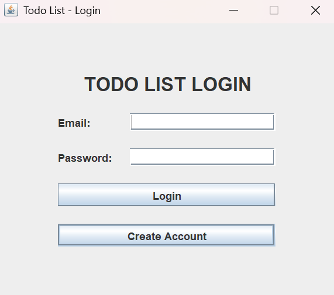
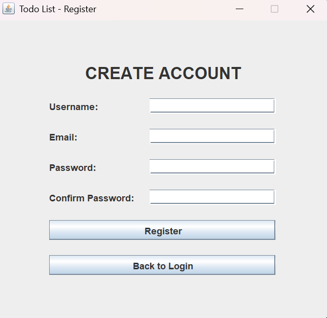
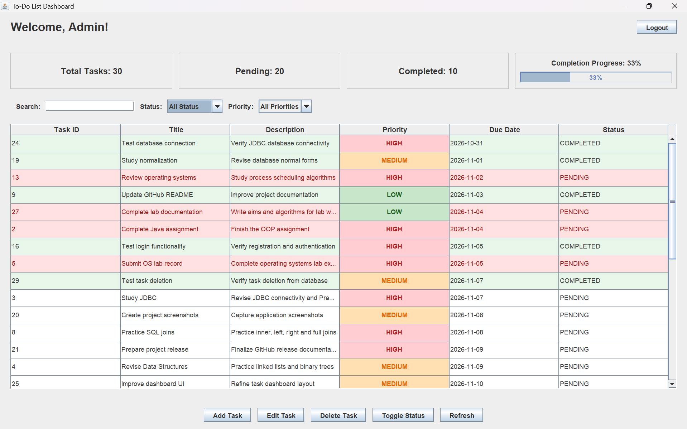
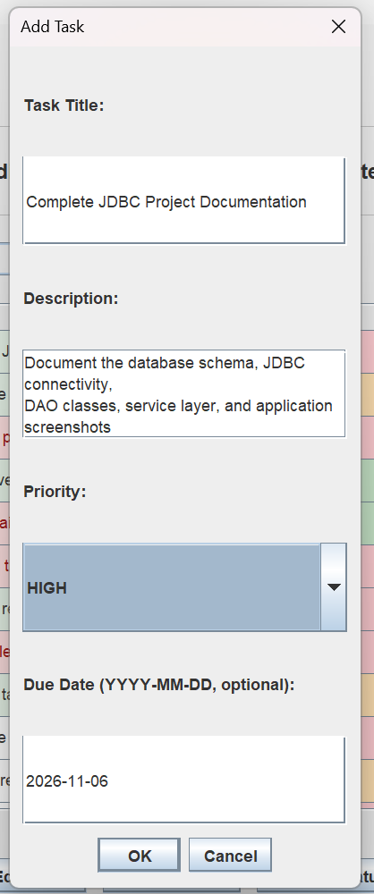
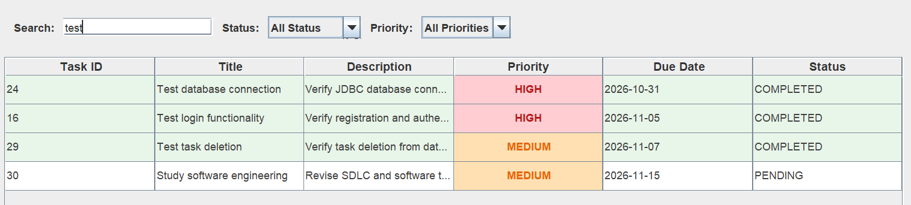

# 📝 To-Do List Application

A desktop-based **To-Do List Management System** built using Java Swing, JDBC, and MySQL. The application allows users to manage their daily tasks through a graphical interface with authentication, task priorities, due dates, and progress tracking.

## 📸 Screenshots

### Login


### User Registration


### Dashboard


### Add Task


### Search Task


## ✨ Features

- User registration and login
- Secure password hashing using BCrypt
- Create, view, update, and delete tasks
- Task priority levels: Low, Medium, High
- Due date management
- Task completion tracking
- Overdue task highlighting
- Dashboard statistics
- Task completion progress bar
- Filter tasks by status and priority
- User-specific task management

## 🛠️ Technologies Used

| Technology | Purpose |
|---|---|
| Java | Application logic |
| Java Swing | Graphical user interface |
| JDBC | Database connectivity |
| MySQL | Database management |
| BCrypt | Password hashing |
| Git & GitHub | Version control |

## 📁 Project Structure

```text
TodoList/
├── src/
│   ├── database/
│   ├── model/
│   ├── dao/
│   ├── service/
│   ├── ui/
│   ├── AuthTest.java
│   ├── TaskTest.java
│   └── Main.java
├── lib/
│   ├── mysql-connector-j.jar
│   └── jbcrypt-0.4.jar
├── database/
│   └── schema.sql
├── screenshots/
├── config.properties
├── .gitignore
└── README.md
```

## ⚙️ Setup and Installation

### 1. Clone the repository

```bash
git clone https://github.com/Collins-Ce/TodoList.git
cd TodoList
```

### 2. Create the database

Execute the SQL script:

```text
database/schema.sql
```

This creates the `todo_db` database and the required tables.

### 3. Configure database connection

Create a `config.properties` file in the project root:

```properties
db.url=jdbc:mysql://localhost:3306/todo_db
db.user=root
db.password=YOUR_MYSQL_PASSWORD
```

Replace the password with your local MySQL password.

**Important:** Never commit your actual `config.properties` file.

### 4. Compile the application

Run the following in PowerShell from the project root:

```powershell
javac -cp "lib/*" -d out (Get-ChildItem -Recurse src -Filter *.java | ForEach-Object FullName)
```

### 5. Run the application

```powershell
java -cp "out;lib/*" ui.LoginFrame
```

## 🔐 Security

- Passwords are hashed using BCrypt.
- SQL queries use PreparedStatements.
- User-specific task operations prevent users from managing other users' tasks.

## 🚀 Future Improvements

- Search tasks by title
- Sort tasks by due date and priority
- Export tasks to CSV
- Task reminders and notifications
- Improved dashboard customization

## 👨‍💻 Author

**Collins Cecil**

GitHub: [Collins-Ce](https://github.com/Collins-Ce)

---


  "One task at a time. One step closer to getting things done."
